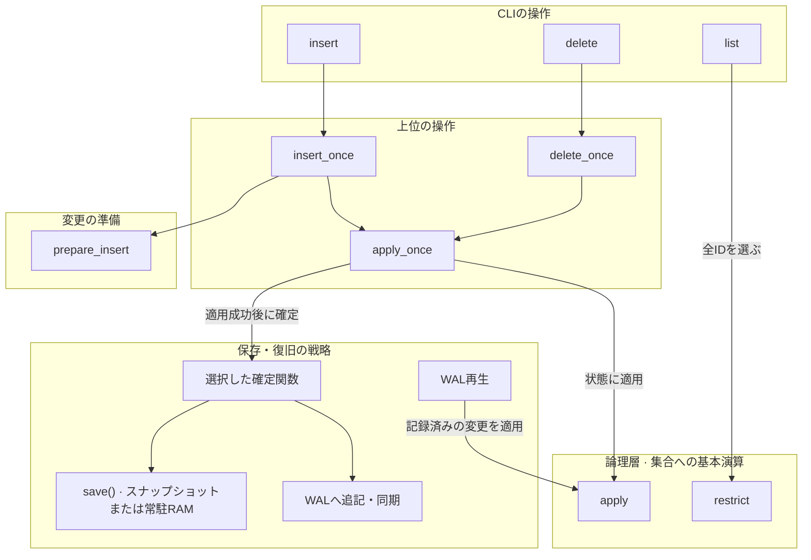
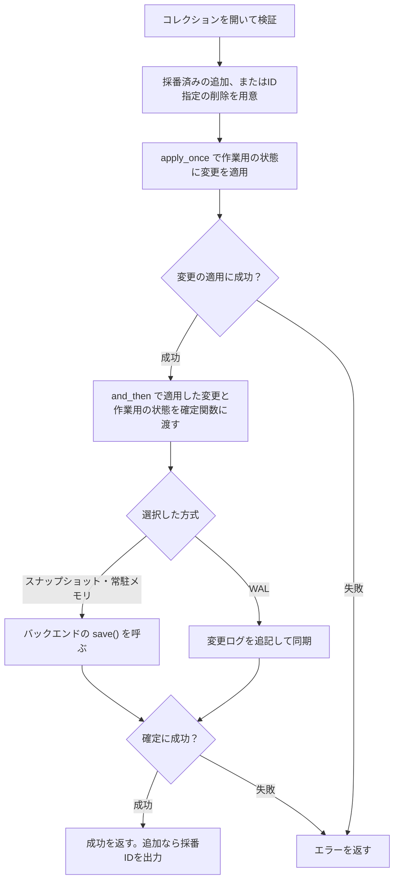

# persist-collections

[English](README.md)

バージョン0.1では、小規模な1コレクションを保存するRustライブラリとCLIを提供します。CLIは `insert`、`list`、`delete`、`backup`、`restore` に対応しています。エラーは標準エラー出力に表示し、終了コードは0以外になります。

Rustのデータ構造、保存バックエンド、ファイル形式をそれぞれ選べるライブラリです。`Stored<C, B>` は値とバックエンドを組み合わせます。`get()` と `get_mut()` で元のRust型にアクセスできます。

| 選択するもの | 組み込みの選択肢 | 拡張方法 |
| --- | --- | --- |
| データ構造 | `Vec<T>`、固定長配列 `[T; N]`、バックエンドが扱える任意の型 | 独自のRust型を `C` に指定 |
| 保存バックエンド | `Memory`、`FileSnapshot<F>`、Unixの `DaemonSnapshot<F>` | `Save<C>` を実装し、読み込みAPIを用意 |
| ファイル形式 | JSON、MessagePack、Postcard | `SnapshotFormat` を実装 |

## はじめ方

最近の安定版RustとCargoを使ってください。使用例はRust 1.93.1で検証しました。CLIを試すには、リポジトリを取得して実行します。

```sh
git clone https://github.com/YoshiakiNishimura/persist-collections.git
cd persist-collections
cargo run -- --help
```

以下の例は実行したディレクトリにファイルを作ります。チェックアウトの外に保存するには、作業用ディレクトリで `cargo run --manifest-path /path/to/persist-collections/Cargo.toml --` に続けてCLIの引数を指定してください。

Rustのプロジェクトから利用するには、`Cargo.toml` に追加します。

```toml
[dependencies]
persist-collections = { git = "https://github.com/YoshiakiNishimura/persist-collections.git" }
```

再現可能な構成にする場合は、検証済みのコミットを `rev` に指定してください。

## コレクションの性質とバージョン

`CollectionShape::SHAPE` で、値を作らずに型の契約を参照できます。

| 型 | 契約 | 要素の指定 | 長さ | 列挙順 | 値の重複 |
| --- | --- | --- | --- | --- | --- |
| `Vec<T>` | `vec@1` | 位置 | 可変 | 位置順 | 許す |
| `[T; N]` | `array@1` | 位置 | `N` に固定 | 位置順 | 許す |
| `IdRecords` | `id_records@1` | 安定した一意のID | 可変 | IDの昇順 | 許す |

```rust
use persist_collections::{CollectionShape, IdRecords, Length};

fn main() -> std::io::Result<()> {
    assert_eq!(<[u32; 8]>::SHAPE.length, Length::Fixed(8));
    assert_eq!(IdRecords::SHAPE.family, "id_records");
    assert_eq!(IdRecords::SHAPE.version, 1);

    let mut records = IdRecords::empty();
    let change = records.prepare_insert("メモ".into())?;
    records.apply(change)?;
    assert_eq!(records.restrict(1..=1)[0].text(), "メモ");
    Ok(())
}
```

`restrict` は構造が定めた定義域の一部を選び、`apply` はその構造が許す変更を適用します。`IdRecords` の定義域は存在するIDの集合で、次の採番IDも状態に含みます。削除しても他のIDと次の採番IDは保たれます。一度公開した契約名とバージョンの組み合わせは意味を固定します。配列の長さ `N` は `array@1` の型パラメータです。

現在は上の3型にメタデータを用意しています。契約バージョンは集合の性質を表し、JSON・Postcardなどの保存形式バージョンとは独立しています。メタデータはRustの型から参照できます。

## 共通の集合操作

`restrict(&collection, selector)` は元の位置やIDと、値への参照を順に返します。`All` は全件、`One(key)` は指定位置・IDの0件または1件、`Matching(predicate)` は条件に合った要素です。条件は列挙しながら評価されます。条件に合う最初の1件だけなら、結果に `.next()` を呼びます。

```rust
use persist_collections::{All, ArrayChange, Matching, One, VecChange, apply, restrict};

fn main() -> std::io::Result<()> {
    let mut values = vec![10, 20, 30];
    assert_eq!(restrict(&values, All).count(), 3);
    assert_eq!(restrict(&values, One(1)).next(), Some((1, &20)));
    let selected = restrict(&values, Matching(|_, value: &i32| *value > 10));
    assert_eq!(selected.map(|(position, _)| position).collect::<Vec<_>>(), [1, 2]);

    apply(&mut values, VecChange::Remove { at: 1 })?;
    let mut slots = [10, 20, 30];
    apply(&mut slots, ArrayChange::Replace { at: 1, value: 99 })?;
    Ok(())
}
```

`apply` が受け取る変更の型は、コレクションごとに決まります。`VecChange` は位置を詰める削除などを含み、`ArrayChange` は長さを保つ置換を受け付けます。`IdRecords` には `IdChange` を使い、`One` では位置に代わってIDを指定します。ID指定は二分探索です。`apply` はメモリ上の変更を適用し、保存は選んだバックエンドで別途行えます。

## CLIで追加・表示・削除する

新しいファイルで、次のコマンドを順に実行します。

```sh
cargo run -- records.json insert "最初のメモ"
cargo run -- records.json insert "2件目のメモ"
cargo run -- records.json list
cargo run -- records.json delete 1
cargo run -- records.json list
```

`insert` は採番したIDを出力します。`list` はID順のJSON配列を出力し、ファイルがまだなければ `[]` を返します。`delete` は対象があれば出力なしで成功し、指定IDが存在しなければエラーになります。レコードと次のIDは一緒に保存され、同じ履歴の中では全件削除後もIDの採番が続きます。

`delete` は `insert` と同じ方式別の確定関数を使います。対象IDが存在しなければ確定関数を呼びません。終了コードは **0** が削除成功、**2** が対象なし、**3** が結果不明、**1** がその他のエラーです。結果不明の場合は削除済みの可能性があるので、再試行前に `list` で対象IDを確認してください。

最後の `list` の出力は次のとおりです。

```json
[{"id":2,"text":"2件目のメモ"}]
```

データには専用のパスを使ってください。CLIは同じパスに対する操作を `records.json.lock` のようなファイル上の協調ロックで調整します。別のツールやライブラリを直接使うコードには、独自の排他制御が必要です。ロックファイルは残しておき、ファイルロックをサポートするローカルのファイルシステムを使ってください。WSLで複数のコマンドを並行実行する場合は、データを `/mnt/c` の外にあるLinux側のファイルシステムに置いてください。

### 関数のレイヤー

矢印は呼び出し先を示します。論理層の基本演算は `restrict` と `apply` です。`prepare_insert` は採番して追加の変更を作る準備処理です。通常の更新は `apply_once` が論理操作と確定処理をつなぎ、WAL再生は記録済みの変更を `apply` に直接渡します。



### insert の確定フロー

論理層ではコレクションを「IDからレコードへの有限な部分関数」として扱い、次の採番IDも状態に持ちます。`restrict` は指定したID範囲に制限する操作で、`list` は全範囲を指定します。`apply` は変更を状態へ適用する操作で、通常の追加・削除とWAL再生が同じ関数を使います。採番は追加の準備で行い、適用時は指定されたIDを使います。

CLIはコレクションを開いて検証します。`insert_once` は採番済みの追加を準備し、`delete_once` は削除するIDを指定します。どちらも `apply_once` で作業用の状態に変更を適用し、選んだ確定関数につなぎます。適用に失敗した場合は確定関数を呼びません。追加時は、CLIが確定に成功してからIDを出力します。



準備した状態は今回の呼び出しが所有します。`save()` がエラーを返した場合でも、保存先ではすでに反映されていることがあります。結果が不明な場合は、再試行する前に開き直して確認してください。

## ファイルの更新・復旧方式を選ぶ

既定の `--strategy snapshot` はファイル全体を置き換えます。`--strategy wal` はローカルのファイルシステム上に作った専用ディレクトリを使います。CLIは方式に対応する読み込みと確定処理をセットで選びます。符号化形式は `--format` で指定し、同じストアでは初回と同じ形式を使ってください。

```sh
mkdir records-wal
cargo run -- --strategy wal --format postcard records-wal insert "最初のメモ"
cargo run -- --strategy wal --format postcard records-wal list
cargo run -- --strategy wal --format postcard records-wal checkpoint
cargo run -- --strategy wal --format postcard records-wal insert "2件目のメモ"
```

追加・削除のたびに、連番とチェックサム付きの変更を1件追記し、ログを同期してから成功を返します。開き直すと、最後のチェックポイントを読み、その後の変更を再生します。書きかけの末尾レコードは読み飛ばし、次の追記前に取り除きます。完全なレコードのチェックサム不一致や連番の欠落はエラーになります。形式情報、チェックポイント、ログ、ロックファイルは同じディレクトリに置いたまま使ってください。

`checkpoint` は現在の全データと最後の連番を保存します。Unixではチェックポイントと親ディレクトリの同期後にログを回収します。Windowsでは親ディレクトリの同期を行えないためログを残します。チェックポイントは手動で、ログ量に応じて再生時間が長くなります。WALストアの `backup` は論理フルを取得し、`restore` は新しいスナップショットファイルを作ります。途中まで書いたログや、古いログが残ったチェックポイントの復旧をテストしています。実機の電源断は未検証です。

## ファイル形式を選ぶ

CLIの既定はJSONです。CLIのビルドには、既定で有効になる `json`、`msgpack`、`postcard`、`checksum` のCargo機能が必要です。ファイルの拡張子は保存形式の選択に影響しません。ファイルを開くたびに同じ形式を `--format` で指定してください。`list` の出力形式はどの保存形式でもJSONです。

```sh
cargo run -- --format msgpack records.msgpack insert "最初のメモ"
cargo run -- --format msgpack records.msgpack list
cargo run -- --format postcard records.postcard insert "最初のメモ"
cargo run -- --format postcard records.postcard list
```

Rust側では `JsonSnapshot`、`MessagePackSnapshot`、`PostcardSnapshot` が同じ `open_vec`、`open_array`、`open_value` を提供します。ファイルの読み書きと置換は `FileSnapshot<F>` が担当します。追加の形式は `SnapshotFormat` を実装して、`FileSnapshot<YourFormat>` として利用できます。データ型と形式はコンパイル時に決まります。

既定では3形式とチェックサム機能が有効です。ライブラリをPostcardだけで使う場合は、依存関係に `default-features = false, features = ["postcard"]` を指定します。Postcardのファイルには形式バージョンが付きます。読み込みには書き込み時と互換性のあるRust型が必要で、保存する型の構造を変更する場合はデータ移行を検討してください。読み込み時は符号化されたスナップショットをメモリに保持します。 [Postcard形式仕様](https://postcard.jamesmunns.com/wire-format)

## Rustから使う

メモリのみで使う場合は `Stored::memory` を選びます。値にSerdeの実装は不要です。

```rust
use persist_collections::Stored;

fn main() {
    let mut numbers = Stored::memory(vec![1, 2]);
    numbers.get_mut().push(3);
    assert_eq!(numbers.into_inner(), vec![1, 2, 3]);
}
```

次の例は固定長配列をJSONに保存し、開き直して値を確認します。試すときは作業用ディレクトリで実行してください。

```rust
use persist_collections::JsonSnapshot;

fn main() -> std::io::Result<()> {
    let mut slots = JsonSnapshot::new("slots.json")?.open_array([0, 0, 0])?;
    slots.get_mut()[1] = 42;
    slots.save()?;

    let reopened = JsonSnapshot::new("slots.json")?.open_array([0, 0, 0])?;
    assert_eq!(reopened.get()[1], 42);
    Ok(())
}
```

`Vec` には `open_vec(vec![1, 2])`、構造体などのSerde対応型には `open_value(initial_value)` を使います。初期値を使うのはファイルが見つからない場合です。データが壊れている場合や配列の長さが異なる場合はエラーを返します。保存先の親ディレクトリは先に作ってください。`Vec` と固定長配列をJSON形式で保存すると、ファイルの内容はJSON配列になります。読み込みには `Deserialize`、保存には `Serialize` が必要です。独自の型にderiveを使う場合は、プロジェクトの依存関係に `serde = { version = "1", features = ["derive"] }` を追加します。

変更の保存には明示的に `save()` を呼びます。値を破棄したときの自動保存はありません。ライブラリから同じファイルを複数の書き手で操作する場合は、読み込みから保存までの排他制御を呼び出し側で行ってください。排他制御がなければ、最後に成功したファイル置換の内容が残ります。独自のバックエンドは `Save<C>` を実装し、`Stored::with_backend` で組み合わせられます。

## 常駐プロセスのメモリを使う

Linux、macOS、WSLでは、端末を1つ開き、ローカルのUnixファイルシステムに非公開ディレクトリを作って常駐プロセスを起動します。

```sh
mkdir -m 700 "$HOME/.persist-collections-demo"
cargo run -- daemon serve "$HOME/.persist-collections-demo/store.sock"
```

別の端末から、同じソケットを指定して操作します。

```sh
cargo run -- --backend daemon --format postcard "$HOME/.persist-collections-demo/store.sock" insert "最初のメモ"
cargo run -- --backend daemon --format postcard "$HOME/.persist-collections-demo/store.sock" list
cargo run -- --backend daemon --format postcard "$HOME/.persist-collections-demo/store.sock" delete 1
```

Rustでは `DaemonSnapshot::<Postcard>::open_vec`、`open_array`、`open_value` にソケットのパスと初期値を渡し、ファイルと同じ `save()` を呼びます。1ソケットにつき1スナップショットを保持します。最初に保存したクライアントが形式を決めるので、以後は同じ形式とRust型を使ってください。独自形式には `daemon::DaemonFormat` で固有の識別子を指定できます。

常駐バックエンドでの保存成功は、そのプロセスのRAMへの反映を意味します。CLIを終了してもデータは残り、常駐プロセスを停止すると消えます。ファイルバックエンドはファイルへの同期と置換を行い、`Memory` は呼び出し元のプロセスに保持します。どの形式で符号化するかとは独立した選択です。

古い状態を持つクライアントからの保存は競合になります。開き直して最新の状態に変更を適用してください。保存応答が途切れたときは、再試行の前に開き直して状態を確認してください。接続は開始時の常駐プロセスに結び付いており、自動再接続は行いません。操作がない接続は30秒で切断します。同時接続は16件、スナップショットは16 MiBまでです。

ソケットのディレクトリにアクセスできる、信頼済みのクライアント向けです。常駐プロセスは Ctrl+C で停止できます。同じパスを再利用するときは、停止を確認して残ったソケットファイルを削除するか、新しいパスを選んでください。Windowsネイティブではファイルバックエンドを利用してください。

## バックアップと復元

```sh
cargo run -- records.json backup backup.json
cargo run -- recovered.json restore backup.json
cargo run -- recovered.json list
```

両コマンドともレコードと次のIDを取得・検証し、新しいファイルに保存します。CLIは読み込み元がファイルなら読み込み中に、書き込み先のファイルは保存中にロックします。破損時は元のファイルを保管し、復元したファイルを確認してから使ってください。復元したファイルでは採番がバックアップ時点に戻るため、それ以降に発行したIDが再び使われる場合があります。バックアップは別の記憶装置にも置いてください。

常駐RAMからのバックアップでは、`--format` が常駐側の形式、`--backup-format` がバックアップファイルの形式です。常駐側に保存済みの状態がなければエラーになります。復元では `--format` が新しいファイルの形式、`--backup-format` が読み込むバックアップの形式です。`--backup-format` を省略すると両方に同じ形式を使います。

```sh
cargo run -- --backend daemon --format postcard --backup-format json-crc32 "$HOME/.persist-collections-demo/store.sock" backup backup.json
cargo run -- --format msgpack --backup-format json-crc32 recovered.msgpack restore backup.json
cargo run -- --format msgpack recovered.msgpack list
```

Rustでは同期API `backup_once(read_snapshot, write_backup)` を使い、取得元と書き込み先を関数やクロージャで渡せます。たとえば `DaemonSnapshot::<F>::read_value` や `FileSnapshot::<F>::read_value` と、`FileSnapshot::<G>::create_value` を組み合わせます。読み込みと復元には同じレコード型を使います。このAPIは取得した時点の状態を丸ごと保存します。実行するタイミングは `save()` から独立して決められます。

## チェックサムで破損を検知する

形式名に `-crc32` を付けます。Rustでは `FileSnapshot<Checked<YourFormat>>` を使います。

```sh
cargo run -- --format postcard-crc32 checked.postcard insert "最初のメモ"
cargo run -- --format postcard-crc32 checked.postcard list
```

CRC-32は、形式として読める値の変化も含め、偶発的な破損の検知に使えます。読み込み時はデータをメモリに保持し、デコード前に検証します。ファイルにはバージョン付きのヘッダーとチェックサムが付きます。チェックサムなしのファイルは元の形式名で開いてください。

## 保存の範囲とテスト

CLIは1ストアに1コレクションを保存します。複数操作をまとめるトランザクションは現在の対象外です。

保存では同じディレクトリに一時ファイルを書き、内容を同期してから保存先を置換します。Unixではその後に親ディレクトリも同期します。その他の環境では親ディレクトリの同期は行いません。保存先がシンボリックリンクの場合はリンク自体が置き換わり、ファイルの権限も変わることがあります。置換後にエラーが出た場合、新しい内容が見えている可能性があるので、再試行前に開き直して状態を確認してください。

`cargo test --locked` で旧ファイルの読み込み、バックアップ・復元を確認できます。保存途中のエラーとプロセス強制終了は、一時ファイルへの書き込み後、ファイル同期後、置換後の3段階で検証します。GitHub ActionsはLinux、Windows、macOSで実行します。実機の電源断からの復旧は未検証です。

## ライセンス

[MIT](LICENSE)
