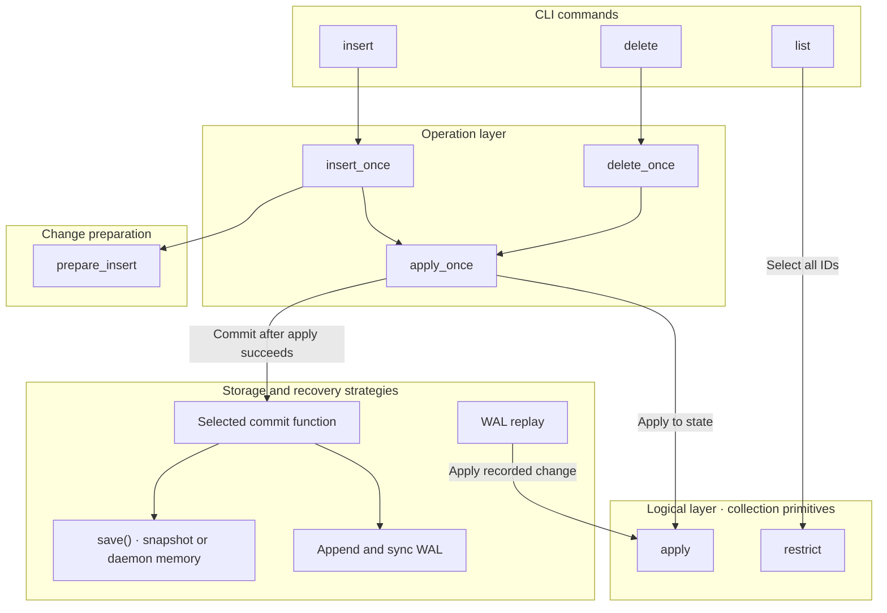
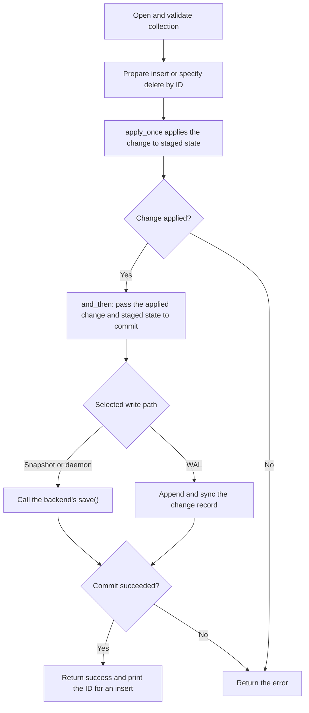

# persist-collections

[日本語](README.ja.md)

Version 0.1 provides a Rust library and a CLI for a single collection of small records. The CLI supports `insert`, `list`, `delete`, `backup`, and `restore`. Errors are written to standard error and return a nonzero exit status.

Choose the data structure, storage backend, and file format separately. `Stored<C, B>` pairs a value with a backend. Use `get()` and `get_mut()` to access the original Rust type.

| Choice | Built in | Extension point |
| --- | --- | --- |
| Data structure | `Vec<T>`, `[T; N]`, and types supported by the selected backend | Pass your own Rust type as `C` |
| Storage backend | `Memory`, `FileSnapshot<F>`, and `DaemonSnapshot<F>` on Unix | Implement `Save<C>` and provide your own loading API |
| Snapshot format | JSON, MessagePack, and Postcard | Implement `SnapshotFormat` |

## Get started

Use a recent stable Rust toolchain with Cargo. The examples were verified with Rust 1.93.1. To try the CLI, clone the repository and run:

```sh
git clone https://github.com/YoshiakiNishimura/persist-collections.git
cd persist-collections
cargo run -- --help
```

The examples below create files in the current directory. To keep those files outside the checkout, run from a working directory and use `cargo run --manifest-path /path/to/persist-collections/Cargo.toml --` before the CLI arguments.

To use the library in your Rust project, add this entry to your `Cargo.toml`:

```toml
[dependencies]
persist-collections = { git = "https://github.com/YoshiakiNishimura/persist-collections.git" }
```

Pin the `rev` field to a tested commit when you need reproducible dependency versions.

## Collection contracts

`CollectionShape::SHAPE` describes the logical structure of the type:

| Type | Contract | Addressing | Length | Order | Duplicate values |
| --- | --- | --- | --- | --- | --- |
| `Vec<T>` | `vec@1` | Position | Variable | Position | Allowed |
| `[T; N]` | `array@1` | Position | Fixed at `N` | Position | Allowed |
| `IdRecords` | `id_records@1` | Stable unique ID | Variable | Ascending ID | Allowed |

```rust
use persist_collections::{CollectionShape, IdRecords, Length};

fn main() -> std::io::Result<()> {
    assert_eq!(<[u32; 8]>::SHAPE.length, Length::Fixed(8));
    assert_eq!(IdRecords::SHAPE.family, "id_records");
    assert_eq!(IdRecords::SHAPE.version, 1);

    let mut records = IdRecords::empty();
    let change = records.prepare_insert("note".into())?;
    records.apply(change)?;
    assert_eq!(records.restrict(1..=1)[0].text(), "note");
    Ok(())
}
```

`restrict` selects within the collection's addressing domain. `apply` takes a change permitted by that collection's contract. For `IdRecords`, the domain is the set of present IDs, and the allocation counter is part of the state. Deletion preserves the counter and other IDs. A published family and version keep their meaning. Array length is a parameter of `array@1`.

Current shape metadata is built in for these three types. It can be read without a collection instance or a codec. The contract version describes logical behavior and is independent from any file format version. The metadata itself lives in the Rust type.

## Common collection operations

`restrict(&collection, selector)` yields original addresses and borrowed values. `All` traverses every entry, `One(key)` yields zero or one entry, and `Matching(predicate)` filters the ordered traversal lazily. Use `.next()` to take the first match.

```rust
use persist_collections::{All, Matching, One, RemoveAt, ReplaceAt, apply, restrict};

fn main() -> std::io::Result<()> {
    let mut values = vec![10, 20, 30];
    assert_eq!(restrict(&values, All).count(), 3);
    assert_eq!(restrict(&values, One(1)).next(), Some((1, &20)));
    let selected = restrict(&values, Matching(|_, value: &i32| *value > 10));
    assert_eq!(selected.map(|(position, _)| position).collect::<Vec<_>>(), [1, 2]);

    apply(&mut values, ReplaceAt { at: 1, value: 99 })?;
    let mut slots = [10, 20, 30];
    apply(&mut slots, ReplaceAt { at: 1, value: 99 })?;
    apply(&mut values, RemoveAt { at: 1 })?;
    Ok(())
}
```

`apply` accepts rules supported by the collection. `ReplaceAt` requires `ReplacePosition` and changes the value at one existing position while preserving the domain. `RemoveAt` requires `RemovePosition` and removes one position, shifting subsequent positions down. Vectors support both capabilities. Fixed arrays support replacement. These requirements are checked at compile time, and the shape metadata describes the collection's contract. The existing `VecChange`, `ArrayChange`, and `IdChange` types are also accepted.

A `One` selection over `IdRecords` takes a stable ID and uses binary search. Apply changes in memory, then use the chosen backend to save them when needed.

| Rule | Required capability | Supported collections |
| --- | --- | --- |
| `Between(bounds)` | Ascending addresses and direct interval traversal | Vectors, arrays, ID records |
| `ReplaceAt` | Replace at an existing position, preserving the domain | Vectors, arrays |
| `PushBack` | Append while preserving existing positions | Vectors |
| `InsertAt` / `RemoveAt` | Shift positions on insertion or removal | Vectors |
| `InsertAllocated` | Insert an assigned key and advance its allocation state | ID records |
| `RemoveByKey` | Remove a unique key while preserving all remaining keys | ID records |

`Between(2..=4)` selects addresses 2 through 4 that exist, keeping their original addresses. `prepare_insert` determines the assigned ID. `InsertAllocated` applies that explicit change during both normal writes and WAL replay. The original change enums delegate to these rules, and their serialized forms remain compatible with existing logs.

## In memory

```rust
use persist_collections::Stored;

fn main() {
    let mut numbers = Stored::memory(vec![1, 2]);
    numbers.get_mut().push(3);
    assert_eq!(numbers.into_inner(), vec![1, 2, 3]);
}
```

Memory mode accepts elements without Serde traits.

## JSON snapshots

Run this example in a working directory with a fresh `slots.json`:

```rust,ignore
use persist_collections::JsonSnapshot;

fn main() -> std::io::Result<()> {
    let mut slots = JsonSnapshot::new("slots.json")?.open_array([0, 0, 0])?;
    slots.get_mut()[1] = 42;
    slots.save()?;

    let reopened = JsonSnapshot::new("slots.json")?.open_array([0, 0, 0])?;
    assert_eq!(reopened.get()[1], 42);
    Ok(())
}
```

For vectors, call `open_vec(vec![1, 2])` with the initial value. Both methods use the initial value when opening the path returns `NotFound`. The first call to `save()` creates the file if its parent directory exists. Malformed JSON, deserialization errors, and a fixed-length array with the wrong number of elements return errors. Opening requires deserializable elements and saving requires serializable elements. The file stores a plain JSON array using Serde's JSON representation.

Each `save()` writes the entire collection to a temporary file in the same directory, syncs the file contents, and replaces the destination. On Unix, it then syncs the parent directory. If that last step fails, the destination may already contain the new snapshot even though save returned an error. On other platforms, the parent directory is left unsynced. Atomic replacement and power-loss durability depend on the filesystem. Saving replaces the destination entry, including a symlink, with a new file and can change file permissions. Use a path in a directory you control. There is no automatic save on drop or interprocess locking. Coordinate writers to the same path externally, including the read-modify-save cycle. Otherwise the last successful replacement wins.

Use the `Save<C>` trait and `Stored::with_backend` to add another backend. Loading is part of the backend's own API.

`open_value` also accepts a Serde type, such as a struct containing a collection and its metadata. The decoder reads directly into that type. To derive the Serde traits for your own types, add `serde = { version = "1", features = ["derive"] }` to your project's dependencies.

## Choose a snapshot format

`JsonSnapshot`, `MessagePackSnapshot`, and `PostcardSnapshot` provide the same `open_vec`, `open_array`, and `open_value` methods. They share `FileSnapshot<F>` for file I/O and replacement. Implement `SnapshotFormat` and use `FileSnapshot<YourFormat>` to add a codec. The format and collection types are resolved at compile time.

All three codecs and checksum support are enabled by default. To use the library with only Postcard, specify `default-features = false, features = ["postcard"]` in Cargo. Postcard payloads use the [Postcard wire format](https://postcard.jamesmunns.com/wire-format) and are prefixed with a file-format version. They require the matching Rust schema on read. Plan a migration when changing the persisted schema. The Postcard decoder buffers the encoded snapshot in memory.

## Single-collection CLI

Start with a fresh data file so the first two records get IDs 1 and 2:

```sh
cargo run -- records.json insert "first note"
cargo run -- records.json insert "second note"
cargo run -- records.json list
cargo run -- records.json delete 1
cargo run -- records.json list
```

`insert` prints a numeric ID. `list` prints a JSON array of records in ID order, or `[]` for a missing snapshot. `delete` exits successfully without output and reports an error for a missing ID. IDs survive restarts and keep increasing even after deleting all records.

`delete` uses the same commit function for the selected storage strategy as `insert`. A missing ID skips the commit. The exit codes are **0** for a confirmed deletion, **2** for a missing record, **3** when the deletion may already have taken effect, and **1** for other errors. On exit code 3, reopen the store with `list` and check the ID before retrying.

The final `list` prints:

```json
[{"id":2,"text":"second note"}]
```

The CLI stores the next ID and records together in the snapshot. Use a dedicated data path for it. CLI invocations using the same path coordinate through an advisory lock on a persistent sidecar, such as `records.json.lock`. Leave that file in place and use a local filesystem with file-lock support. Other tools and library callers must coordinate independently. On WSL, keep concurrent data files on the Linux filesystem rather than under `/mnt/c`.

JSON is the CLI default. Building the CLI requires the `json`, `msgpack`, `postcard`, and `checksum` features, which are enabled by default. The filename extension has no effect on format selection. To select a binary format, pass it on each invocation:

```sh
cargo run -- --format msgpack records.msgpack insert "first note"
cargo run -- --format msgpack records.msgpack list
cargo run -- --format postcard records.postcard insert "first note"
cargo run -- --format postcard records.postcard list
```

Choose the format when creating a store and use the same selection when reopening it. The CLI prints `list` as JSON for every file format. Existing JSON files continue to work with the default commands.

### Function layers

Each arrow points from a caller to the function it invokes. The logical primitives are `restrict` and `apply`. The preparation step, `prepare_insert`, assigns an ID and builds an insert change. For a normal write, `apply_once` connects the logical operation to the selected commit function. WAL replay passes previously recorded changes directly to `apply`.



### How an insert is committed

The CLI models a collection as a finite partial function from IDs to records, with a separate next ID. `restrict` selects records in an ID interval and `list` uses the full interval. `apply` changes the state and is shared by normal writes and WAL replay. Insert preparation determines the ID, and `apply` uses that explicit ID without allocating another one.

The CLI opens and validates the collection. `insert_once` prepares an allocated insert, and `delete_once` supplies the requested ID. Both use `apply_once` to apply the change to a staged state and compose it with the selected commit function. A failure to apply the change skips commit. The CLI prints the insert ID after commit succeeds.



The function owns the staged state for this invocation. If save returns an error, the backend may already have applied the update. Reopen the store and inspect the records before retrying when the outcome is unclear.

## Select a file write and recovery strategy

`--strategy snapshot` is the default and writes a full replacement file. `--strategy wal` uses a dedicated directory on a local filesystem. The CLI selects the matching open and commit paths together. The codec is selected independently with `--format` and must match on every subsequent command for that store.

```sh
mkdir wallet-wal
cargo run -- --strategy wal --format postcard wallet-wal insert "first note"
cargo run -- --strategy wal --format postcard wallet-wal list
cargo run -- --strategy wal --format postcard wallet-wal checkpoint
cargo run -- --strategy wal --format postcard wallet-wal insert "second note"
```

Each insert or delete writes one checksummed record with a sequence number, then syncs the log before reporting success. On open, the CLI loads the last checkpoint and replays later entries. Recovery ignores an incomplete final frame and removes it before the next append. A complete frame with a bad checksum or a sequence gap is an error. The directory contains the format metadata, checkpoint, log, and lock file. Keep them together and preserve the lock file.

`checkpoint` publishes the entire current state and its last sequence number. On Unix, the CLI syncs the checkpoint and its directory before reclaiming the log. On Windows, the log is retained because the file backend cannot sync the directory. Checkpoints are manual, so plan for log growth and replay time. The CLI supports logical `backup` from WAL stores and restores it to a new snapshot file. Recovery tests simulate interrupted log writes and an already-published checkpoint with an old log. Physical power-loss recovery remains unverified.

## Copy-on-write B+ tree

Choose `--strategy cow-btree` for a file-backed ordered collection in a new dedicated directory. Internal pages route by ID and leaf pages store records. `get <id>` reads one path and returns a JSON record or `null`. `range <first> <last>` visits the pages intersecting the inclusive interval and streams a JSON array in ID order. The same commands also work with snapshot and WAL stores.

```sh
mkdir tree-store
cargo run -- --strategy cow-btree --format postcard tree-store insert "first note"
cargo run -- --strategy cow-btree --format postcard tree-store get 1
cargo run -- --strategy cow-btree --format postcard tree-store range 1 10
```

The B+ tree defines search, range traversal, and how to split or prune pages. It asks a page store to write new or replacement pages. The copy-on-write strategy writes replacements at fresh locations, syncs the page file, then publishes the new root and next ID together. Readers navigate from the published root.

Empty branches can be pruned; partially filled pages are retained. This implementation uses a store lock and retains old pages. Page space reclamation and CLI backup/restore for this strategy are future work. Keep the root and page file together.

## Compose restrictions by condition

Combine typed predicates with `.and(...)` and pass the result to `restrict`. Intersecting two predicates selects the same entries as applying the two restrictions in sequence.

```rust
use persist_collections::{IdRecords, RecordPredicate, restrict};

fn main() -> std::io::Result<()> {
    let mut records = IdRecords::empty();
    records.apply(records.prepare_insert("note".into())?)?;
    let condition = RecordPredicate::IdBetween(1..=10).and(RecordPredicate::TextEq("note"));
    assert_eq!(restrict(&records, condition).map(|(id, _)| id).collect::<Vec<_>>(), [1]);
    Ok(())
}
```

The CLI `query <text> [<first-id> <last-id>]` matches exact text. The optional inclusive ID interval is composed with the text condition. A B+ tree uses the interval to start the read and checks the text only on the candidates it visits. A text-only query traverses the whole collection.

## Share a snapshot through a local daemon

On Linux, macOS, or WSL, start a daemon in one terminal. Use a new private directory on the local Unix filesystem:

```sh
mkdir -m 700 "$HOME/.persist-collections-demo"
cargo run -- daemon serve "$HOME/.persist-collections-demo/store.sock"
```

In another terminal, point each command to that socket:

```sh
cargo run -- --backend daemon --format postcard "$HOME/.persist-collections-demo/store.sock" insert "first note"
cargo run -- --backend daemon --format postcard "$HOME/.persist-collections-demo/store.sock" list
cargo run -- --backend daemon --format postcard "$HOME/.persist-collections-demo/store.sock" delete 1
```

In Rust, use `DaemonSnapshot::<Postcard>::open_vec`, `open_array`, or `open_value` with the socket path and a fallback. Call `save()` as with a file backend. The socket stores one snapshot, and the first save establishes its codec. Use the same codec and Rust schema for subsequent clients. Custom codecs can implement `daemon::DaemonFormat` with an identifier unique to their encoding.

A successful daemon save confirms that the snapshot reached the daemon's RAM. It survives CLI exits and is cleared when the daemon exits. File snapshots use file synchronization and replacement; in-process memory keeps state in the caller. The format choice is independent of these lifetimes.

Concurrent clients holding stale snapshots receive a conflict. Reopen and apply the intended change to the latest state. If the connection drops while saving, reopen and inspect the data before retrying. Each connection is tied to the daemon process that opened it, and the client never reconnects automatically. Idle sessions expire after 30 seconds. The daemon supports 16 active connections and snapshots up to 16 MiB.

The socket is local to trusted clients with access to its directory. Stop the daemon with Ctrl+C. Before reusing the socket path, confirm the process has stopped and remove its leftover socket file, or choose a new path. Native Windows supports the file backend.

## Recovery and backup

The crash tests terminate a child process after writing the temporary file, after syncing it, and after publishing it. The save failure tests inject errors at the same checkpoints. A failure after publication can leave the complete new state visible, so reopen the file before retrying an update. The tests cover process termination and injected failures. Power-loss durability depends on the filesystem and platform. Unix syncs the parent directory after publication.

Create a backup and restore it to a separate path:

```sh
cargo run -- records.json backup backup.json
cargo run -- recovered.json restore backup.json
cargo run -- recovered.json list
```

Both commands capture and validate the records and next ID, then write them to a new destination file. File sources are locked while read, and the CLI locks the destination while writing. Restore preserves the records and next ID from the backup, so IDs issued after the backup may be reused in the recovered store. Keep backups on independent storage and retain the damaged file for diagnosis. Tests include fixed snapshots for the original JSON, MessagePack, and Postcard layouts.

To back up a daemon using a different format, set `--format` to the live store's format and `--backup-format` to the archive's format. A daemon with no saved snapshot returns an error. For restore, `--format` selects the new file's format and `--backup-format` selects the archive's format. Omitting `--backup-format` uses the same format for both.

```sh
cargo run -- --backend daemon --format postcard --backup-format json-crc32 "$HOME/.persist-collections-demo/store.sock" backup backup.json
cargo run -- --format msgpack --backup-format json-crc32 recovered.msgpack restore backup.json
cargo run -- --format msgpack recovered.msgpack list
```

Rust callers can use the synchronous `backup_once(read_snapshot, write_backup)` with typed functions or closures. Pair `DaemonSnapshot::<F>::read_value` or `FileSnapshot::<F>::read_value` with `FileSnapshot::<G>::create_value` to copy a complete snapshot. Use the same record type to read and restore it. A caller can choose when to invoke it independently of `save()`. This API performs a full backup of a single captured state.

## Optional checksums

Use `FileSnapshot<Checked<YourFormat>>` in Rust or add `-crc32` to a CLI format, such as `--format postcard-crc32`. The wrapper buffers the encoded payload on read and verifies a CRC-32 before decoding. It can detect accidental changes, including altered values that still parse. The file uses a versioned header and stores the checksum. Open existing unchecked snapshots with their original format names. Use CRC-32 for accidental corruption detection only.

```sh
cargo run -- --format postcard-crc32 checked.postcard insert "first note"
cargo run -- --format postcard-crc32 checked.postcard list
```

## Scope

The CLI manages one collection per store. It supports standalone insert and delete operations. Multi-operation transactions are outside the current scope. Process termination tests run on Linux, Windows, and macOS. Physical power-loss recovery remains unverified.

## Verify

Run `cargo test --locked` from the repository root. GitHub Actions runs the suite on Linux, Windows, and macOS.

## License

[MIT](LICENSE)
